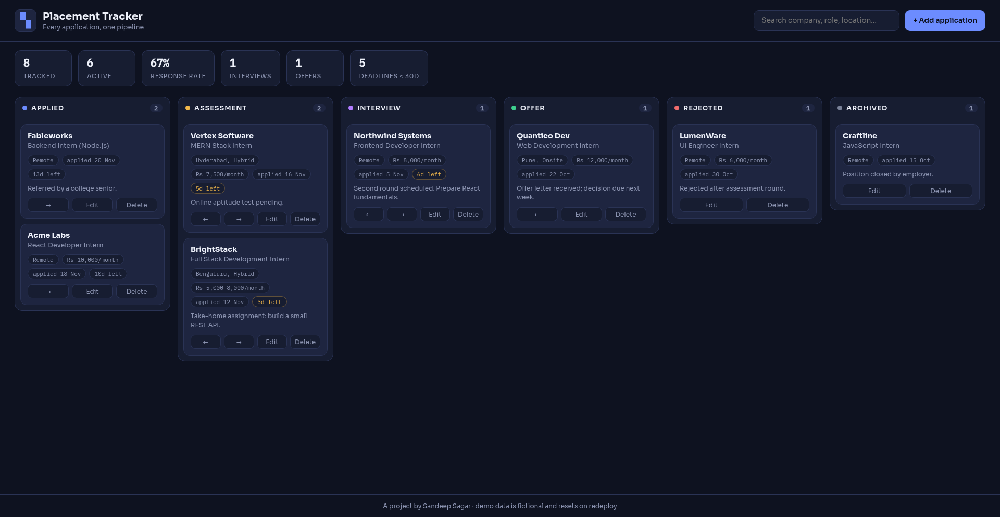

# Placement Tracker

Track internship and job applications end to end: pipeline stages, deadlines, notes and a live stats dashboard. Built as a series of daily milestones.

## Live

**https://placement-tracker-ofa8.onrender.com**

Demo mode note: the free deploy uses embedded in-memory Postgres, so demo data is fictional and resets whenever the service redeploys or restarts. Setting `DATABASE_URL` switches the same code to a durable hosted Postgres.



## Stack

- Node.js + Express REST API
- PostgreSQL - real SQL in every environment:
  - `DATABASE_URL` set (production) → hosted Postgres via `pg`
  - no `DATABASE_URL` (local/demo/CI) → embedded Postgres via PGlite, same schema and queries
- `node:test` suite that runs against real Postgres and gates every deploy

## API

| Method | Route | Description |
| --- | --- | --- |
| GET | `/api/health` | Liveness plus which database backend is active |
| GET | `/api/applications?status=&q=` | List applications, filter by stage, free-text search |
| POST | `/api/applications` | Create an application (records its first history entry) |
| GET | `/api/applications/:id` | One application with its full status history |
| PATCH | `/api/applications/:id` | Edit fields; a status change appends a history entry |
| DELETE | `/api/applications/:id` | Remove an application and its history |
| GET | `/api/stats` | Stage counts, response rate, upcoming deadlines |

Stages: `applied → assessment → interview → offer`, plus `rejected` and `archived` from any stage.

## Run locally

```bash
npm install
npm test          # 17 tests against embedded Postgres
npm start         # http://localhost:3000 (seeds fictional demo data on first boot)
```

Against a hosted database:

```bash
DATABASE_URL=postgres://... npm start
```

## Demo data

Demo mode seeds fictional companies only (Northwind Systems, BrightStack, Acme Labs, ...). A public demo must never carry a real person's private applications.

## Roadmap

- [x] M1 - schema, store, REST API, stats, tests
- [x] M2 - pipeline UI (kanban board, drag and drop, search, add/edit modal, stats bar)
- [ ] M3 - deadline reminders and richer analytics
- [ ] M4 - polish: hosted Postgres, auth, performance

A project by Sandeep Sagar
